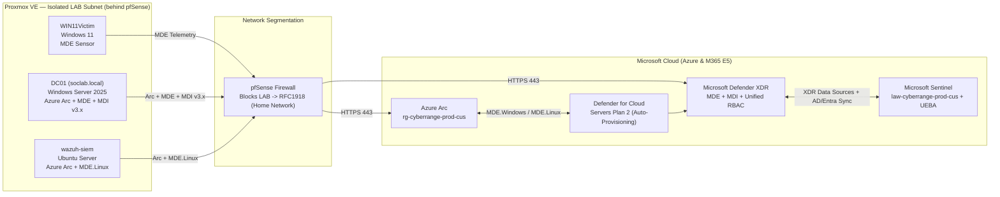
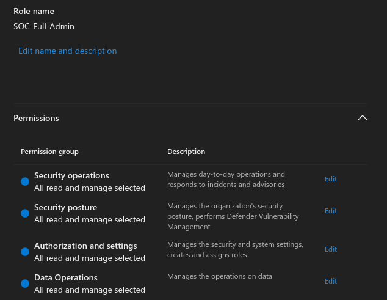
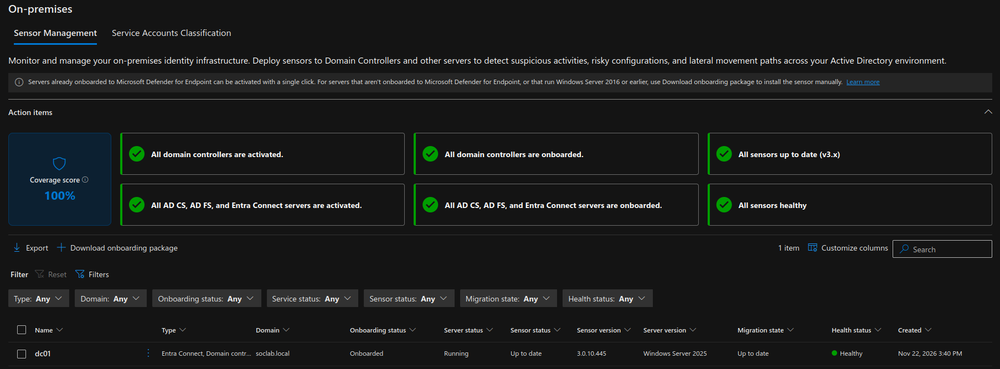
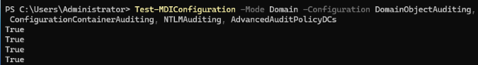
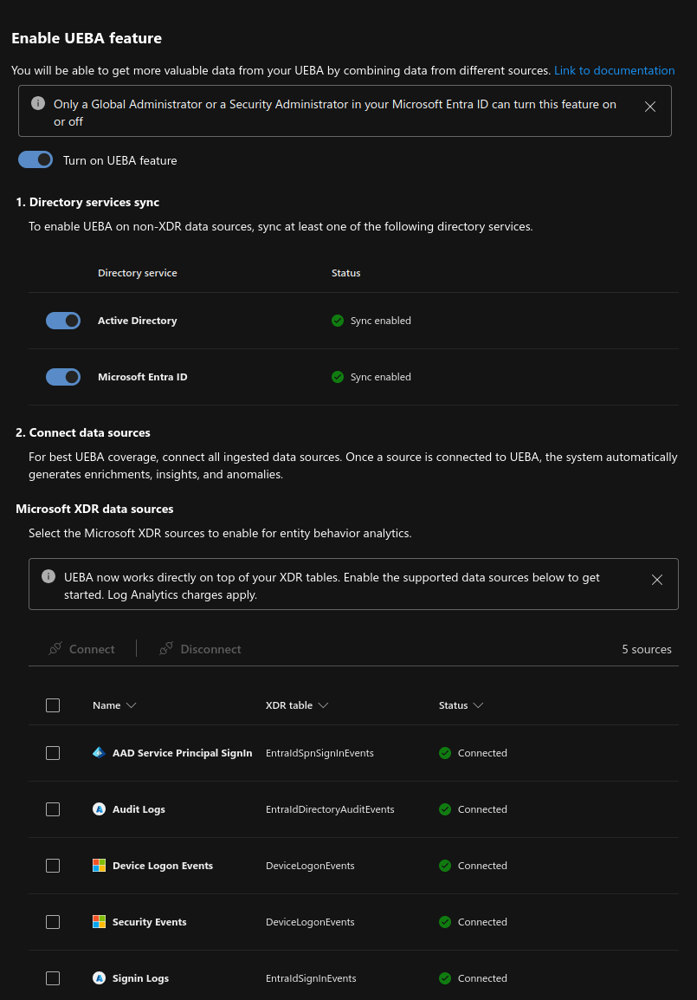
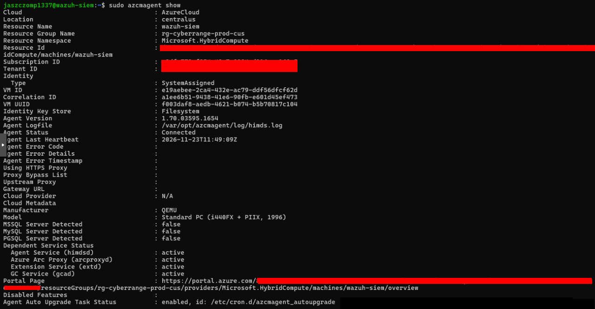
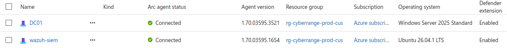
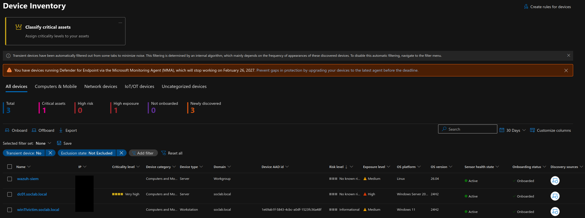
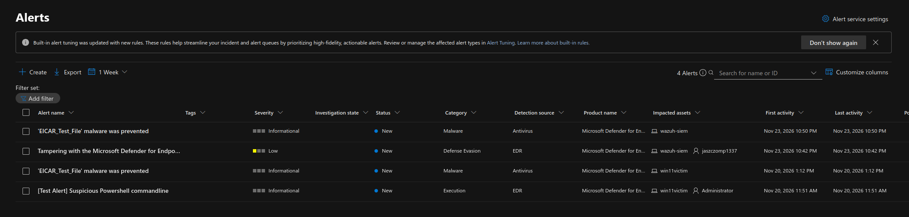

# Phase 2: Hybrid Infrastructure Onboarding, MDI v3.x, Sentinel UEBA & Detection Validation


## 1. Executive Summary & Target Architecture

The objective of **Phase 2** was to extend cloud-native security monitoring and detection capabilities from Microsoft Azure into an isolated, on-premises **Proxmox VE** cyber range segmented behind a **pfSense** firewall. 

Key engineering goals achieved in this phase:
* **Cross-Platform Endpoint Visibility:** Unified EDR/EPP onboarding across **Windows 11**, **Windows Server 2025**, and **Ubuntu Server** into **Microsoft Defender XDR**.
* **Identity Protection:** Deployment and hardening of the unified **Microsoft Defender for Identity (MDI) v3.x** sensor on the Active Directory Domain Controller (`DC01`), paired with validated AD auditing policies.
* **Hybrid Behavioral Analytics:** Integration of both **Microsoft Entra ID** and on-premises **Active Directory** into **Microsoft Sentinel UEBA**, enriched with native Microsoft XDR data streams.
* **Zero Trust & Least Privilege Discipline:** Resolved real-world onboarding blockers (network segmentation, Entra ID Security Defaults, Unified RBAC) without weakening network isolation or tenant-wide security controls.



### Protected Asset Inventory (End of Phase 2)

| Hostname | Operating System | Role / Domain | Onboarding Method | Active Security Controls & Status |
| :--- | :--- | :--- | :--- | :--- |
| **`WIN11Victim`** | Windows 11 | Workstation (`soclab.local`) | Direct MDE Onboarding | MDE **Onboarded / Active** |
| **`DC01`** | Windows Server 2025 | Domain Controller (`soclab.local`) | Azure Arc (`MDE.Windows`) | MDE **Active** + MDI v3.x (**100% Coverage**, AD Audit `4x True`) |
| **`wazuh-siem`** | Ubuntu Server | Linux Server (`workgroup`) | Azure Arc (`MDE.Linux`, SP Auth) | MDE **Active**, RTP Enabled, Verified **EDR + AV** Detections |

---

## 2. Microsoft Defender for Identity (MDI v3.x) & Unified RBAC Configuration

Rather than deploying legacy standalone MDI v2.x sensors requiring dedicated Directory Services Accounts (DSA/gMSA), this lab leverages the modern **MDI v3.x** architecture integrated directly into the MDE agent running under `LocalSystem` on **Windows Server 2025 (`DC01`)**.

### Engineering Challenge #1: `HTTP 403` / `System.InvalidOperationException` in MDI Sensor Management

After enabling *Automatic sensor v3.x activation* under **Defender XDR → Settings → Identities**, navigating to **On-premises → Sensor Management** returned a generic portal error banner despite valid Microsoft 365 E5 licensing.

* **Root Cause Analysis:** Inspecting browser DevTools (**Network → Fetch/XHR**) isolated an `HTTP 403 Forbidden` response with `System.InvalidOperationException` against the backend API endpoint `.../defensor/onboarding/devices/sensor_compatible_machines`. On modern tenants, Microsoft has deprecated legacy auto-generated `Azure ATP` Entra ID groups in favor of **Microsoft Defender XDR Unified RBAC**. Even with *Global Administrator*, the new `defensor` microservice required explicit RBAC scoping.
* **Resolution & Architectural Decision:**
  1. Assigned the **Security Administrator** role in Microsoft Entra ID to the SOC administrative account.
  2. Created a dedicated **Defender XDR Unified RBAC** custom role (`SOC-Full-Admin`) granting full read/manage permissions across *Security operations*, *Security posture*, *Authorization and settings*, and *Data Operations*, scoped to **All available data sources**.
  3. **Deliberate Sentinel Separation:** Left the Microsoft Sentinel workspace (`law-cyberrange-prod-cus`) governed by **Azure RBAC** instead of switching it to Defender Unified RBAC workload activation. This prevented accidental lockout of administrative/Break-Glass accounts that rely on Azure subscription ownership.
  4. Performed a full sign-out/sign-in cycle to force a fresh authorization token.

>  **\[Screenshot: Defender XDR Unified RBAC SOC-Full-Admin Role\]**
> 

Once permissions propagated, the API returned `200 OK`, confirming automatic v3.x activation on `DC01` with a **100% Coverage Score**.

---

## 3. Sensor Health Hardening & Active Directory Auditing Validation (`DC01`)

### Engineering Challenge #2: Outdated Sensor Health Alert & Legacy `Identity:` Prompt

Following activation, two final hardening items remained on `DC01`:

1. **Sensor Version Outdated Alert:** The portal flagged `1 sensor not healthy (sensor version outdated)`. Because the MDI v3.x sensor shares its update lifecycle with the OS and MDE platform, installing pending Windows Server 2025 cumulative updates and forcing a Defender platform/signature update brought the sensor to a **Healthy** state:
   ```powershell
   & "$env:ProgramFiles\Windows Defender\MpCmdRun.exe" -SignatureUpdate
   ```
2. **AD Auditing Verification (MDI v3.x Specifics):** Installing the `DefenderForIdentity` PowerShell module and running `Test-MDIConfiguration -Mode Domain -Configuration All` prompted for an interactive `Identity:` parameter. This parameter belongs to the legacy `RemoteSAM` check (designed for v2.x DSA/gMSA accounts). Targeting the four core Domain Controller auditing configurations revealed an initial state of `False, False, False, True`.
3. **Remediation:** Applied the required domain auditing policies and verified full compliance (`4x True`):
   ```powershell
   Install-PackageProvider -Name NuGet -MinimumVersion 2.8.5.201 -Force
   Install-Module -Name DefenderForIdentity -Force -AllowClobber
   Import-Module DefenderForIdentity

   Set-MDIConfiguration -Mode Domain -Configuration DomainObjectAuditing, ConfigurationContainerAuditing, NTLMAuditing, AdvancedAuditPolicyDCs
   Test-MDIConfiguration -Mode Domain -Configuration DomainObjectAuditing, ConfigurationContainerAuditing, NTLMAuditing, AdvancedAuditPolicyDCs
   ```

### Live Telemetry Validation via KQL (Advanced Hunting)

Active ingestion of on-premises Kerberos, NTLM, and LDAP authentication telemetry from `DC01` was verified in **Defender XDR → Advanced Hunting**:

```kql
IdentityLogonEvents
| where Timestamp > ago(24h)
| where Protocol in ("Kerberos", "NTLM", "Ldap")
| project Timestamp, ActionType, Protocol, AccountName, DeviceName, DestinationDeviceName
| order by Timestamp desc
| take 20
```

>  **\[Screenshot: MDI Sensor Management 100% Coverage & Healthy Status\]**
>  

>  **\[Screenshot: PowerShell Test-MDIConfiguration 4x True\]**
> 

---

## 4. Hybrid Identity Integration in Microsoft Sentinel UEBA

To enable behavioral anomaly detection across both cloud and on-premises identities (e.g., anomalous logons, lateral movement, privilege escalation), **Microsoft Sentinel UEBA** was configured under **Settings → Microsoft Sentinel → Entity behavior analytics**:

* **Directory Services Sync:** Enabled both **Microsoft Entra ID** and **Active Directory** (powered natively by the MDI sensor on `DC01`).
* **Microsoft XDR Data Sources:** Connected all five native XDR telemetry tables:
  * `AAD Service Principal SignIn Logs` (`EntraIdSpnSignInEvents`)
  * `Audit Logs` (`EntraIdDirectoryAuditEvents`)
  * `Device Logon Events` (`DeviceLogonEvents`)
  * `Security Events` (`DeviceLogonEvents`)
  * `Signin Logs` (`EntraIdSignInEvents`)
* **Scope Hygiene:** Non-applicable third-party Sentinel connectors (AWS CloudTrail/GuardDuty, GCP, Okta) were intentionally left disconnected.

>  **\[Screenshot: Microsoft Sentinel UEBA Hybrid Sync & XDR Data Sources\]**
> 

---

## 5. Linux Server Onboarding (`wazuh-siem`) via Azure Arc & Defender for Cloud

The Ubuntu Server (`wazuh-siem`) was onboarded to Azure Arc inside resource group `rg-cyberrange-prod-cus` (`centralus`, tags: `workload=cyberrange`, `env=prod`) with **Automatic agent upgrade** enabled and unnecessary features (*Connect SQL Server*, *TPM-backed identity*) disabled.

### Engineering Challenge #3: Network Segmentation Timeout (`curl: (28)`)

* **Symptom:** Attempting to pull `OnboardingScript.sh` onto Ubuntu from a temporary Python HTTP server hosted on the management workstation in the home subnet (`192.168.1.0/24`) resulted in `curl: (28) failed to connect`.
* **Root Cause:** Local host firewalls (`ufw`) were verified inactive on both endpoints. Reviewing **pfSense** rules confirmed the outbound isolation rule blocking traffic from the lab LAN toward `192.168.1.0/24` was functioning as intended.
* **Resolution:** Rather than punching temporary firewall exceptions that weaken lab-to-home isolation, the onboarding script was transferred strictly inside the segmented lab subnet via `DC01` over SSH (`scp`).

### Engineering Challenge #4: Device Code Flow Blocked by Security Defaults (`AADSTS530035`)

* **Symptom:** Because the Ubuntu server runs headless (no GUI), `azcmagent` defaulted to OAuth2 **Device Code Flow** (`https://login.microsoft.com/device`). Authenticating from an external browser failed with **`Error Code: 530035`**.
* **Root Cause:** **Microsoft Entra ID Security Defaults** enforces a block on Device Code Flow to mitigate *Device Code Phishing* attacks.
* **Resolution (Least Privilege & Credential Hygiene):** Instead of temporarily disabling tenant-wide Security Defaults:
  1. Created a short-lived **Service Principal** (`sp-arc-onboarding`) in **Azure Arc → Service principals**, strictly scoped to resource group `rg-cyberrange-prod-cus` with only the **`Azure Connected Machine Onboarding`** role.
  2. Authenticated the installed `azcmagent` directly via CLI:
     ```bash
     sudo azcmagent connect \
       --service-principal-id "<CLIENT_ID>" \
       --service-principal-secret "<CLIENT_SECRET>" \
       --resource-group "rg-cyberrange-prod-cus" \
       --tenant-id "<TENANT_ID>" \
       --location "centralus" \
       --subscription-id "<SUBSCRIPTION_ID>" \
       --cloud "AzureCloud" \
       --tags "workload=cyberrange,env=prod"
     ```
  3. Verified `Agent Status : Connected` (`sudo azcmagent show`), immediately **deleted `sp-arc-onboarding`** from Azure once the machine-assigned identity certificate took over communication.

> 📸 **\[Screenshot: Entra ID Security Defaults Blocking Device Code Flow (530035)\]**
> 

> 📸 **\[Screenshot: Ubuntu azcmagent Connected Status\]**
> 

### Automated `MDE.Linux` Provisioning via Defender for Cloud

With **Microsoft Defender for Servers Plan 2** (*Endpoint protection* auto-provisioning) active on the subscription, Azure automatically deployed the **`MDE.Linux`** extension to `wazuh-siem` within ~45 minutes, reaching **`Provisioning succeeded`** without manual agent installation. All three operating systems (`win11victim.soclab.local`, `dc01.soclab.local`, and `wazuh-siem`) now appear as **Onboarded / Active** in Defender XDR.

> 📸 **\[Screenshot: Azure Arc Hybrid Machines Connected\]**
> 

> 📸 **\[Screenshot: Defender XDR Devices Inventory - Full OS Coverage\]**
> 

---

## 6. Linux Active Protection Hardening & Dual-Layer Detection Validation

Post-deployment inspection via `mdatp health` confirmed `healthy : true` and `licensed : true`, but revealed **`real_time_protection_enabled : false`**—the default safe posture for Linux servers onboarded via Azure Arc to avoid disrupting production workloads prior to administrator verification.

### Enabling Active Real-Time Protection (RTP)

```bash
sudo mdatp config passive-mode --value disabled
sudo mdatp config real-time-protection --value enabled
mdatp health --field passive_mode_enabled
mdatp health --field real_time_protection_enabled
```

### Validating Both EDR (Behavioral) and EPP (Signature) Layers

Testing on `wazuh-siem` successfully validated two distinct detection layers inside Microsoft Defender XDR:

1. **Behavioral EDR Detection — MITRE ATT&CK `T1562.001` (*Impair Defenses: Disable or Modify Tools*):**  
   Toggling the agent into passive mode (`sudo mdatp config passive-mode --value enabled`) immediately fired the high-fidelity alert **`Tampering with the MS Defender for Endpoint sensor`** with full command-line telemetry—demonstrating visibility into adversary defense-evasion attempts on Linux endpoints.
2. **Signature-Based Prevention (AV / EPP) — EICAR Test File:**  
   With passive mode disabled and RTP enabled, retrieving the harmless EICAR test string triggered immediate blocking, quarantine, and the alert **`EICAR_Test_file malware was prevented`**:
   ```bash
   curl -o /tmp/eicar.com.txt https://secure.eicar.org/eicar.com.txt
   mdatp threat list
   ```

> 📸 **\[Screenshot: Defender XDR Alerts - Sensor Tampering (T1562.001) & EICAR Prevented\]**
> 

After capturing evidence, both validation incidents were triaged and closed in the SOC queue with classification **`Informational, expected activity → Security testing`** to maintain a clean alert baseline for upcoming attack simulations.

---

## 7. Real-World Troubleshooting & Security Lessons Learned

| Incident / Blocker | Root Cause | Remediation Implemented | Security Engineering Takeaway |
| :--- | :--- | :--- | :--- |
| **`HTTP 403`** in MDI *Sensor Management* | Deprecated legacy `Azure ATP` groups; `defensor` API requires Defender Unified RBAC | Created `SOC-Full-Admin` Unified RBAC role + Entra `Security Administrator`; kept Sentinel on Azure RBAC | *Global Admin* does not guarantee access to modern XDR microservices; separating Sentinel RBAC protects Break-Glass resilience |
| **MDI `sensor version outdated`** & `Identity:` prompt | Pending OS/MDE updates; `-Configuration All` triggers legacy v2.x `RemoteSAM` check | Updated Windows Server 2025 + targeted `Set-MDIConfiguration` across 4 DC policies (`4x True`) | MDI v3.x inherits its update lifecycle from OS/MDE and operates via `LocalSystem` without a legacy DSA account |
| **`curl: (28)` Timeout** transferring Arc script | pfSense segmentation rule dropping LAB → home subnet (`192.168.1.0/24`) | Transferred script internally within the lab subnet via `DC01` / `scp` | Validates firewall isolation; avoid punching temporary firewall holes during administration |
| **`AADSTS530035`** on headless Linux onboarding | Entra ID Security Defaults blocks OAuth2 Device Code Flow | Used a scoped temporary Service Principal (`Azure Connected Machine Onboarding`), ran `history -c`, deleted SP | Never weaken tenant-wide identity controls when a least-privilege non-interactive authentication path exists |
| **`real_time_protection_enabled: false`** on Linux | Default non-intrusive posture after Azure Arc `MDE.Linux` auto-provisioning | Explicitly disabled `passive-mode`, enabled `real-time-protection`, verified via EDR & EICAR tests | An `Onboarded` status alone does not equal active prevention—always validate sensor enforcement posture |

---

## 8. Next Steps — Phase 3 Preview

With full hybrid visibility established across endpoints (`WIN11Victim`, `DC01`, `wazuh-siem`), on-premises Active Directory (MDI v3.x), and cloud/hybrid behavioral analytics (Sentinel UEBA), **Phase 3** will focus on **Purple Team Attack Simulations (MITRE ATT&CK)**, KQL Threat Hunting, and custom Microsoft Sentinel Analytic Rules.